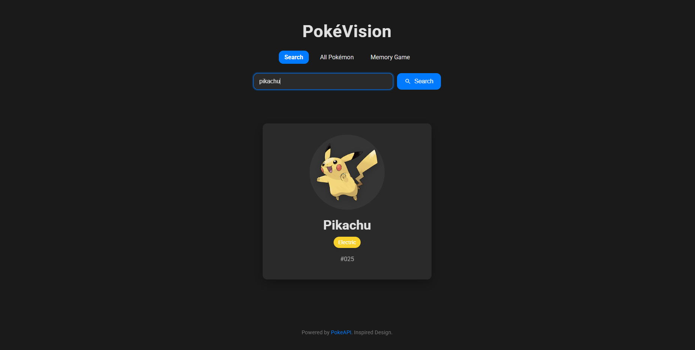
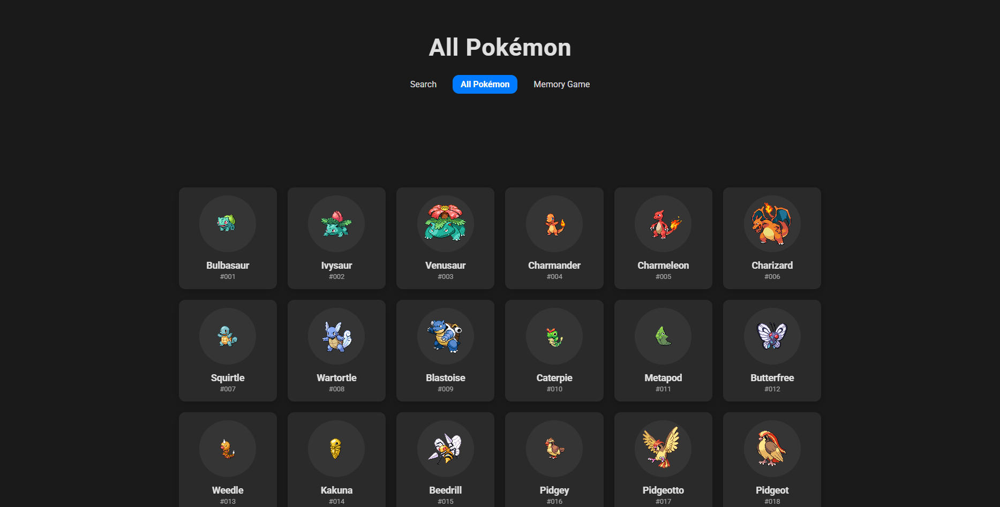
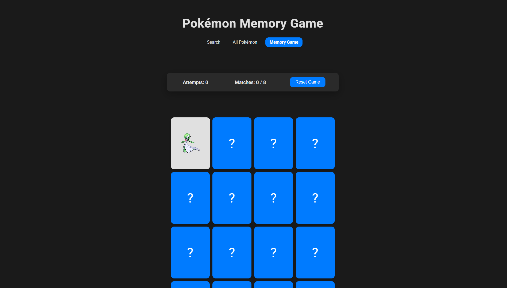

# PokéVision

A small, dependency-free web app on top of the [PokeAPI](https://pokeapi.co/): look up any Pokémon, browse the full list page by page, or play a card-matching memory game. Built as a practice project for asynchronous JavaScript and DOM manipulation.

**Live demo:** https://poke-vision-app.vercel.app

Context: Coding Temple 2025 JavaScript project (a single-assignment exercise, not a production app).

## Features

- **Search** (`index.html`): enter a name or National Pokédex number to see the Pokémon's artwork, name, zero-padded ID and color-coded type badges. Unknown names get a "not found" message; other API failures get a separate error message.
- **All Pokémon** (`all-pokemon.html`): a grid of every Pokémon returned by the API, 40 per page, with Previous/Next controls and a "Page X of Y" indicator. Clicking a card opens the search page with that Pokémon already loaded.
- **Memory game** (`memory-game.html`): 8 random Pokémon, 16 face-down cards. Flip two at a time to find pairs; the game counts attempts and matches, shows a win message, and can be reset to deal a new set.
- Loading and error states on every page, CSS card-flip and fade-in animations, and responsive breakpoints for smaller screens.

## Tech stack

- HTML5, CSS3 (Grid, Flexbox, 3D transforms, keyframe animations)
- Vanilla JavaScript (ES6+): `fetch`, `async`/`await`, optional chaining
- [PokeAPI](https://pokeapi.co/) for data; sprites from the PokeAPI sprites repository on GitHub
- No framework, no build step, no npm dependencies

## How it works

- **One list request, client-side paging.** `all-pokemon.js` fetches `/pokemon?limit=1500` once, then slices the array in memory for each 40-item page. Each sprite URL is built from the ID parsed out of the result's `url`, so the grid needs no per-Pokémon detail request. Images use `loading="lazy"` and fall back to a transparent placeholder if a sprite is missing.
- **Pages linked by query string.** List cards navigate to `index.html?pokemon=<name>`. On load, `script.js` reads the `pokemon` query parameter and runs the same `handleSearch()` used by the search button, so a list click and a typed search follow one code path.
- **Distinct error handling in search.** `script.js` checks `response.ok`, throws a "not found" error for HTTP 404 and a generic API error otherwise, and clears the loading state in a `finally` block. Artwork falls back from `official-artwork` to the default sprite.
- **Memory game state.** `memory-game.js` takes 24 Pokémon from a random offset in the list endpoint, picks 8, duplicates each into a pair, and shuffles the deck with Fisher-Yates. A `lockBoard` flag ignores clicks while two cards are face up, including the 800 ms delay before a mismatched pair flips back.

## Getting started

Prerequisites: a modern web browser. Internet access is required at runtime because all data comes from the PokeAPI.

```bash
git clone https://github.com/Aldonvacriates/poke-vision-app.git
cd poke-vision-app
```

Then either open `index.html` directly in a browser, or serve the folder with any static file server, for example:

```bash
npx serve .
# or
python -m http.server 8000
```

There are no environment variables, API keys or install steps. There are no automated tests.

## Project structure

```
poke-vision-app/
├── index.html         # Search page
├── script.js          # Search logic and ?pokemon= auto-search
├── all-pokemon.html   # Paginated list page
├── all-pokemon.js     # List fetch, paging and card rendering
├── memory-game.html   # Memory game page
├── memory-game.js     # Deck building, shuffle, flip and match logic
├── style.css          # Shared styles for all three pages
└── images/            # README screenshots
```

## Screenshots

**Search page**



**All Pokémon list**



**Memory game**



## What I'd improve next

- Pull the duplicated `displayMessage` / `clearMessages` helpers into one shared module instead of three copies.
- Make the memory cards and list cards keyboard-accessible (they are click-only `div` elements today).
- Read the total count from the API instead of the hardcoded `limit=1500` and random-offset cap of 800.
- Add a few unit tests for the shuffle and match logic.

## Credits

Pokémon data and sprites come from [PokeAPI](https://pokeapi.co/). Pokémon names and images belong to their respective owners; this is a non-commercial learning project.
